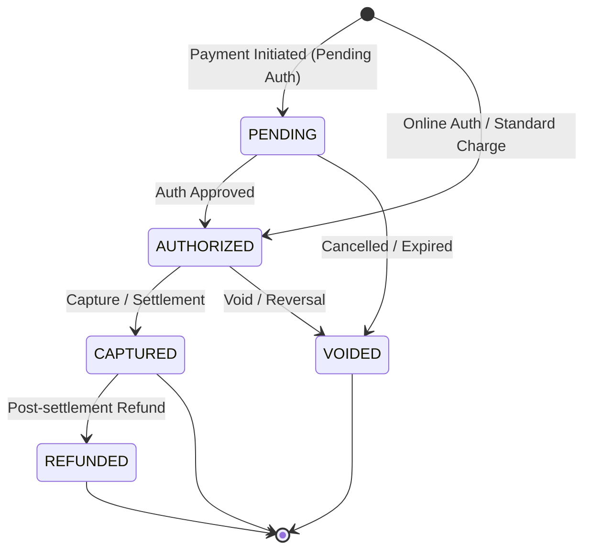

# MOST Travel Payment Gateway & Back-Office System

An enterprise-grade, lightweight FastAPI payment gateway and back-office engine simulated after **MOST** (modern onboard store and travel retail payment platforms for airlines and rail).

This system solves the unique challenges of mobility and travel fintech:
- **Intermittent & Low-Connectivity Operations**: Crew POS terminals operate offline inflight, storing transactions securely and syncing in batches upon landing (Store-and-Forward).
- **Zero Double-Charge Guarantees**: Strict financial idempotency using the `Idempotency-Key` header prevents duplicate deductions caused by satellite/Wi-Fi connection retries.
- **Strict Financial State Machine**: Explicit transaction state transitions preventing unauthorized or invalid state movements.
- **Back-Office Reconciliation**: Real-time aggregation of transaction counts and volume broken down by settlement status and currency.

---

## 1. Transaction Workflow State Machine



### Transition Matrix
| Current State | Allowed Next State(s) | Description |
| :--- | :--- | :--- |
| `PENDING` | `AUTHORIZED`, `VOIDED` | Pre-auth hold or async processing |
| `AUTHORIZED` | `CAPTURED`, `VOIDED` | Funds held on customer line of credit |
| `CAPTURED` | `REFUNDED` | Funds captured and settled to merchant account |
| `REFUNDED` | *Terminal State* | Settled funds returned to customer |
| `VOIDED` | *Terminal State* | Hold released prior to settlement |

Any illegal transition (e.g., attempting to capture an already captured or voided payment) returns HTTP `422 Unprocessable Content` with detailed explanation.

---

## 2. Project Architecture & Directory Structure

```text
Most/
├── app/
│   ├── __init__.py
│   ├── config.py           # Application settings & environment configuration
│   ├── database.py         # SQLAlchemy engine, session maker, get_db dependency
│   ├── models.py           # ORM models (Transaction) & State Machine rules
│   ├── schemas.py          # Pydantic v2 validation models
│   ├── services.py         # Fintech domain logic (Idempotency, Sync, Reconciliation)
│   ├── main.py             # FastAPI entrypoint, lifespan events, middleware
│   └── api/
│       ├── __init__.py     # Router aggregator
│       ├── payments.py     # Payment creation, capture, void, refund, offline sync
│       └── reconciliation.py # Back-office reconciliation summaries
├── tests/
│   ├── __init__.py
│   ├── conftest.py         # Test configuration, in-memory SQLite engine & async HTTPX fixtures
│   ├── test_payments.py    # Happy path lifecycle (PENDING->AUTHORIZED->CAPTURED) & negative tests
│   ├── test_idempotency.py # Financial deduplication & zero DB duplicate assertions
│   ├── test_offline_sync.py # Inflight store-and-forward batch ingestion & partial duplicate handling
│   └── test_reconciliation.py # Back-office financial reporting validation
├── requirements.txt        # Production & test dependencies
├── seed_demo.py            # Utility script to populate sample transactions
└── README.md
```

---

## 3. Database Schema

The SQLite database (`travel_payments.db`) is mapped using SQLAlchemy:

| Column | Type | Constraints | Description |
| :--- | :--- | :--- | :--- |
| `id` | `VARCHAR(36)` | PRIMARY KEY | Client-generated or server UUID |
| `idempotency_key` | `VARCHAR(128)` | UNIQUE, INDEXED, NOT NULL | Deduplication key across network retries |
| `amount` | `NUMERIC(12, 2)` | NOT NULL | Financial amount (represented as `Decimal`) |
| `currency` | `VARCHAR(3)` | INDEXED, NOT NULL | ISO-4217 3-letter currency code (e.g. `USD`, `EUR`) |
| `status` | `VARCHAR(20)` | INDEXED, NOT NULL | `PENDING`, `AUTHORIZED`, `CAPTURED`, `REFUNDED`, `VOIDED` |
| `description` | `VARCHAR(255)` | NULLABLE | Transaction or item summary |
| `metadata_json` | `TEXT` | NULLABLE | Flight ID, seat number, terminal ID, batch details |
| `created_at` | `DATETIME` | UTC, NOT NULL | Audit creation timestamp |
| `updated_at` | `DATETIME` | UTC, NOT NULL | Audit update timestamp |

---

## 4. Setup & Running the Service

### Prerequisites
- Python 3.10+
- `pip`

### Step 1: Install Dependencies
```bash
pip install -r requirements.txt
```

### Step 2: (Optional) Seed Demo Data
```bash
python seed_demo.py
```

### Step 3: Start the Gateway
```bash
uvicorn app.main:app --reload --port 8000
```
The server will start on `http://127.0.0.1:8000`.

- **Interactive Swagger UI**: [http://127.0.0.1:8000/docs](http://127.0.0.1:8000/docs)
- **ReDoc Documentation**: [http://127.0.0.1:8000/redoc](http://127.0.0.1:8000/redoc)

---

## 5. Endpoints & API Reference

### 1. `POST /api/v1/payments`
Creates a new payment transaction with `Idempotency-Key` header handling.

#### Request Headers
- `Idempotency-Key`: *(string, Recommended)* Unique client request key (UUID).

#### Request Body
```json
{
  "amount": 75.50,
  "currency": "USD",
  "description": "Inflight WiFi + Duty Free",
  "metadata": {
    "flight_id": "AA-100",
    "seat": "14B"
  },
  "auto_authorize": true
}
```

#### Response (`201 Created` on new, `200 OK` on idempotent replay)
```json
{
  "id": "e6a2eb2d-0b19-482f-87a4-84c164d50901",
  "idempotency_key": "tx-client-uuid-12345",
  "amount": "75.50",
  "currency": "USD",
  "status": "AUTHORIZED",
  "description": "Inflight WiFi + Duty Free",
  "metadata": {
    "flight_id": "AA-100",
    "seat": "14B"
  },
  "created_at": "2026-10-27T19:00:00Z",
  "updated_at": "2026-10-27T19:00:00Z"
}
```

*Note: When repeating the request with the identical `Idempotency-Key`, the system responds with `200 OK` and the header `Idempotent-Replay: true`, preventing double debiting.*

---

### 2. `POST /api/v1/payments/{id}/capture`
Transitions an `AUTHORIZED` payment to `CAPTURED`.

#### Request Body (Optional)
```json
{
  "amount": 75.50,
  "reason": "Flight completed, batch settlement"
}
```

#### Response (`200 OK`)
```json
{
  "id": "e6a2eb2d-0b19-482f-87a4-84c164d50901",
  "idempotency_key": "tx-client-uuid-12345",
  "amount": "75.50",
  "currency": "USD",
  "status": "CAPTURED",
  "description": "Inflight WiFi + Duty Free",
  "metadata": {
    "flight_id": "AA-100",
    "seat": "14B",
    "capture_reason": "Flight completed, batch settlement"
  },
  "created_at": "2026-10-27T19:00:00Z",
  "updated_at": "2026-10-27T19:05:00Z"
}
```

---

### 3. `POST /api/v1/payments/sync-offline-batch`
Ingests offline transactions collected during flight by cabin crew POS terminals. If an offline transaction was already ingested, it is skipped gracefully without rejecting valid records.

#### Request Body
```json
{
  "batch_id": "BATCH-LH402-20261027",
  "flight_id": "LH-402",
  "terminal_id": "POS-CREW-PAD-03",
  "transactions": [
    {
      "idempotency_key": "LH402-SEAT-01A-SNACK",
      "amount": 14.00,
      "currency": "EUR",
      "description": "Croissant & Cappuccino",
      "status": "CAPTURED"
    },
    {
      "idempotency_key": "LH402-SEAT-12C-DUTYFREE",
      "amount": 120.00,
      "currency": "EUR",
      "description": "Duty Free Perfume",
      "status": "CAPTURED"
    }
  ]
}
```

#### Response (`200 OK`)
```json
{
  "batch_id": "BATCH-LH402-20261027",
  "total_received": 2,
  "processed": 2,
  "duplicates_skipped": 0,
  "errors": 0,
  "results": [
    {
      "idempotency_key": "LH402-SEAT-01A-SNACK",
      "transaction_id": "2bc8f154-1b32-446a-b44c-9dd603f95e26",
      "status": "SYNCED",
      "message": "Transaction persisted successfully."
    },
    {
      "idempotency_key": "LH402-SEAT-12C-DUTYFREE",
      "transaction_id": "b9015c9e-561b-4fa6-8575-cf0ef6631ad1",
      "status": "SYNCED",
      "message": "Transaction persisted successfully."
    }
  ]
}
```

*If the terminal re-sends the batch after network disconnection, `duplicates_skipped` increments while returning success and existing transaction IDs.*

---

### 4. `GET /api/v1/reconciliation`
Returns back-office reconciliation summaries grouped by transaction status and currency breakdown.

#### Query Parameters
- `currency`: *(Optional string)* Filter by currency (e.g. `USD`, `EUR`).

#### Response (`200 OK`)
```json
{
  "generated_at": "2026-10-27T19:15:00Z",
  "total_transactions": 5,
  "total_volume": "612.50",
  "by_status": [
    { "status": "PENDING", "count": 0, "total_amount": "0.00" },
    { "status": "AUTHORIZED", "count": 1, "total_amount": "350.00" },
    { "status": "CAPTURED", "count": 3, "total_amount": "242.50" },
    { "status": "REFUNDED", "count": 1, "total_amount": "20.00" },
    { "status": "VOIDED", "count": 0, "total_amount": "0.00" }
  ],
  "by_currency": [
    {
      "currency": "USD",
      "count": 3,
      "total_amount": "547.50",
      "breakdown_by_status": {
        "AUTHORIZED": "350.00",
        "CAPTURED": "197.50"
      }
    },
    {
      "currency": "EUR",
      "count": 2,
      "total_amount": "65.00",
      "breakdown_by_status": {
        "CAPTURED": "45.00",
        "REFUNDED": "20.00"
      }
    }
  ]
}
```

---

## 6. Running the Automated Test Suite

Execute pytest across the test suite:
```bash
pytest
```
The test suite validates:
- [x] Health check endpoints.
- [x] Payment creation with `Idempotency-Key`.
- [x] Idempotent replays returning existing transactions without double charging.
- [x] Authorization-to-capture transition flow.
- [x] Transition guards (rejection of illegal state movements like double capture).
- [x] Void and refund lifecycle endpoints.
- [x] Inflight store-and-forward batch ingestion with graceful duplicate handling.
- [x] Reconciliation aggregation and currency grouping calculations.
