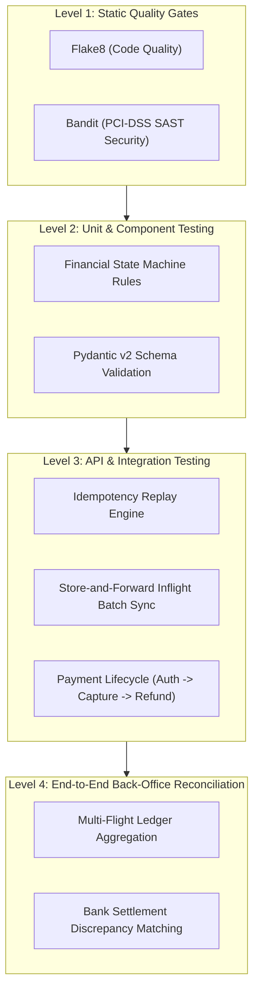

# IEEE 829 / ISTQB Test Plan: MOST Travel Payment Gateway & Back-Office System

| Document Metadata | Details |
| :--- | :--- |
| **Document ID** | TP-MOST-GW-2026-V1 |
| **Project** | MOST Inflight Retail Payment Gateway & Back-Office Reconciliation |
| **Author** | Senior Quality Assurance Engineer |
| **Standard** | IEEE 829 / ISTQB Advanced Test Management |
| **Status** | Approved / Baseline |

---

## 1. Executive Summary & Context

MOST provides financial and travel retail software for high-mobility, low-connectivity transit operations (airlines and passenger rail). The platform operates at the intersection of **Fintech** (zero double-charge guarantees, strict state transitions, PCI-DSS security) and **Edge Retail** (offline store-and-forward batch syncing from portable crew POS terminals).

This Test Plan defines the verification strategy for the core payment gateway, offline batch ingestion, and back-office reconciliation ledger.

---

## 2. Scope of Testing

### 2.1 In-Scope
* **Core Payment Gateway API**: Direct payments (`PENDING`, `AUTHORIZED`, `CAPTURED`, `VOIDED`, `REFUNDED`).
* **Financial Idempotency**: Deduplication via `Idempotency-Key` across satellite and Wi-Fi network reconnects.
* **Inflight Store-and-Forward Sync**: Batch ingestion of offline transactions from portable POS terminals (`POST /api/v1/payments/sync-offline-batch`).
* **Back-Office Reconciliation Engine**: Financial aggregation of settled volume and transaction counts grouped by status and ISO currency (`GET /api/v1/reconciliation`).
* **Quality Gates & Security**: SAST analysis (`bandit`), PEP-8 compliance (`flake8`), minimum 85% code coverage enforcement in CI/CD.

### 2.2 Out-of-Scope (Mocked / Simulated)
* Physical hardware smartcard chip reader driver testing (simulated via API contract payload).
* Live banking host HSM network connection (simulated via local authorization engine).

---

## 3. Risk Assessment & Mitigation Matrix

| Risk ID | Domain Risk Description | Severity | Probability | Mitigation & QA Test Approach |
| :--- | :--- | :---: | :---: | :--- |
| **R-01** | **Satellite / Wi-Fi Network Flakiness**: Terminal resends transaction multiple times, leading to customer double debit. | **Critical** | High | Automated idempotency tests (`test_idempotency.py`) verifying DB single-record constraint and HTTP 200 replay header. |
| **R-02** | **Offline Batch Duplication**: Crew terminal disconnects midway through batch upload and retransmits entire batch. | **High** | High | Idempotent batch ingestion test (`test_offline_sync.py`) verifying duplicate items are skipped (`duplicates_skipped`) while valid items persist. |
| **R-03** | **Illegal State Transitions**: Crew voids a transaction already settled, causing financial shortfall. | **Critical** | Low | Negative state machine tests (`test_payments.py`) asserting strict HTTP 422 rejection on illegal transitions. |
| **R-04** | **Currency Rounding Discrepancy**: Multi-currency ledger aggregations accumulate fractional-cent drift. | **High** | Medium | Precision testing using Python `Decimal` with assertions matching exact banking settlement totals down to 0.01. |
| **R-05** | **PCI-DSS Cardholder Data Leakage**: Sensitive card details logged in plaintext in server logs. | **Critical** | Low | Automated Bandit security scan in CI/CD and log audit assertions ensuring tokenization and masking. |

---

## 4. Test Strategy & Levels

1. **Static Analysis & Security (Level 1)**: Integrated into `buildspec.yml` and `Jenkinsfile`.
2. **Component & State Validation (Level 2)**: Verification of enum transitions (`models.py`) and schema boundaries.
3. **API & Integration Testing (Level 3)**: Fast, in-memory SQLite isolation with `httpx.AsyncClient`.
4. **End-to-End Reconciliation (Level 4)**: Audit matching against external acquirer settlement files.

---

## 5. Traceability Matrix & Test Scenarios

| Test Case ID | Test Scenario | Expected Outcome | Automated Test File |
| :--- | :--- | :--- | :--- |
| **TC-IDEM-01** | Resend payment with identical `Idempotency-Key` and amount. | HTTP 200, `Idempotent-Replay: true`, 1 DB record. | `tests/test_idempotency.py` |
| **TC-IDEM-02** | Submit request with distinct idempotency keys. | 2 distinct payments created with unique UUIDs. | `tests/test_idempotency.py` |
| **TC-SYNC-01** | Ingest batch of 10 offline transactions from Flight AA-100. | Total received: 10, Processed: 10, Duplicates: 0. | `tests/test_offline_sync.py` |
| **TC-SYNC-02** | Resend batch containing 3 existing and 2 new transactions. | Processed: 2, Duplicates Skipped: 3, Errors: 0. | `tests/test_offline_sync.py` |
| **TC-STATE-01** | Capture transaction in `AUTHORIZED` state. | State moves to `CAPTURED`, audit timestamps updated. | `tests/test_payments.py` |
| **TC-STATE-02** | Attempt illegal capture on already `CAPTURED` payment. | HTTP 422 Unprocessable Entity, error detail logged. | `tests/test_payments.py` |
| **TC-STATE-03** | Attempt illegal void on `CAPTURED` payment (must use refund). | HTTP 422 Unprocessable Entity with guidance. | `tests/test_payments.py` |
| **TC-RECON-01** | Aggregate multi-flight transactions across USD, EUR, GBP. | Correct count, sum, and per-status breakdown. | `tests/test_reconciliation_e2e.py` |
| **TC-RECON-02** | Compare internal ledger against external bank settlement file. | Zero discrepancy on balanced ledger; flags discrepancy on mismatch. | `tests/test_reconciliation_e2e.py` |

---

## 6. Entry and Exit Criteria

### Entry Criteria
* Source code compiles without syntax errors.
* Python dependencies installed (`requirements.txt`).
* Database migrations and schemas initialized.

### Exit Criteria (Production Readiness)
* 100% of automated test scenarios pass (`18/18+ passed`).
* Overall statement coverage $\ge 85\%$ (Current: **90%**).
* Zero High/Medium vulnerabilities reported by Bandit SAST.
* Zero flake8 linting violations.
* Automated CI/CD pipeline completes in under 3 minutes.

---

## 7. Bug Triage & CAPA (Corrective and Preventative Actions)

When a defect is discovered (e.g. from crew tech support or staging tests):
1. **Severity Classification**:
   * **Sev-1 (Blocker)**: Financial discrepancy, duplicate charge, offline data loss.
   * **Sev-2 (Major)**: Endpoint failure with known workaround, non-blocking UI discrepancy.
   * **Sev-3 (Minor)**: Cosmetic logging or documentation issue.
2. **Root Cause Analysis (RCA)**: Trace POS terminal log $\rightarrow$ API Gateway access log $\rightarrow$ DB audit row.
3. **Corrective Action**: Fix code or schema immediately.
4. **Preventative Action (CAPA)**: Write a regression test matching the exact bug scenario so it can never recur in CI/CD.
